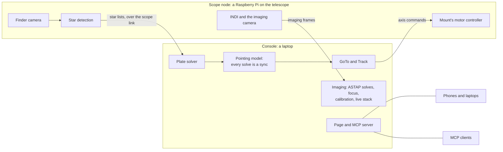
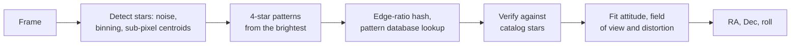

# plate-solver

[](https://github.com/bryantharpeorg/plate-solver/actions/workflows/ci.yml)

An electronic finder and GoTo controller for a Dobsonian, built on a fast star-field plate
solver written in Rust. A small camera on the finder scope watches the sky, and each frame is
solved in a few milliseconds to where the telescope really points, with no star alignment and
no prior pointing. The finder console uses that to guide a push by hand, drive the mount's own
motors to a target and track it, and run an imaging camera from focus to a saved stack. A
Raspberry Pi rides on the telescope, a laptop does the maths, and you use it from your phone.

Its plate solver re-implements [cedar-detect](https://github.com/smroid/cedar-detect) and
[cedar-solve](https://github.com/smroid/cedar-solve), the star detector and solver behind the
[Cedar](https://github.com/smroid/cedar-server) electronic finder, which build in turn on ESA's
[tetra3](https://github.com/esa/tetra3). Their authors deserve the credit for those algorithms
([Prior work](#prior-work)). The rest is this project's own: the scope node, the pointing model,
GoTo and tracking, the imaging side, the page and the MCP server.

## What it does at the telescope

[Status](#status) says which of these have been proven under the sky so far.

- **Knows where it points.** Every finder frame is plate-solved to RA/Dec, roll and field of
  view, with no starting position needed, and the matched catalog stars are drawn on the frame
  as the proof.
- **Push-to.** Search a target by Messier, NGC or IC number or common name (from OpenNGC). The
  page says which way to push, in the observer's own directions, and marks the target and the
  eyepiece's spot on the live chart. The Sun guard and a minimum altitude are always on.
- **GoTo with no star alignment.** Every solve is a sync, and a pointing model is fitted from
  them. GoTo slews on the mount's own motors, solves, and corrects until the target is within 1′
  of the eyepiece's spot, or halts and says why.
- **Tracking.** Alt-az rates from the pointing model, corrected by the finder camera's solves
  and, while stacking, by the subs themselves. A push by hand is followed, not fought. The
  readout gives the field rotation and the longest exposure for your imaging camera.
- **Imaging.** An imaging camera through INDI: frames saved as FITS and plate-solved with ASTAP,
  a focus aid, darks and flats, and a live stack that leaves satellite streaks out. An imaging
  run goes from GoTo through a focus check and centring to a saved stack on its own.
- **An AI assistant can drive it.** The console is an [MCP](#use-it-with-an-ai-assistant)
  server, so a client such as Claude can find targets, GoTo, track and image, under the same
  guards as the page.
- **Built for the dark.** The page is made for a phone held in one hand, with a red-only night
  mode. Every phone and laptop on the network shares one observing session, and the page says
  when the mount has not confirmed a Stop.

## Status

Early, and looking for [feedback](#feedback-wanted). There is one rig so far: a 16-inch
Dobsonian.

**Proven at the telescope**, on 12 to 14 November 2026
([field report](docs/field/2026-11-13-first-light.md)):

- Live plate solving from the finder camera: a 13.0° × 9.8° field at 17 to 20″ RMS, a frame
  every 3 s.
- Push-to by hand with the live guidance, onto the Double Cluster, the Pleiades, M42 and
  NGC 253.
- Powered moves on the mount's own motors, sent over MCP: eight single-axis moves of up to 1°,
  each ending within about 17″ of where it was sent.

**Built, and tested in the simulator and CI, but not yet at the telescope:** GoTo to a target,
the second sync, tracking, a Stop the mount confirms, and the whole imaging side.

**Designed, not built:** a hands-free [voice mode](docs/voice/README.md).

The solver gives cedar's answers on cedar's sample frames, and runs faster
([comparison](#how-the-solver-compares-with-cedars)).

## Try it without a telescope

The simulator stands in for the telescope. It renders catalog stars through the real camera
port, star detection, scope link and solver, with a simulated mount and imaging camera, on a
virtual clock.

You need Rust ([rustup](https://rustup.rs)) and `protoc` (Debian and Ubuntu:
`sudo apt install protobuf-compiler`, and see [Development](#development)). It has been run on
Linux, on Ubuntu under WSL2.

```sh
git clone --depth 1 https://github.com/bryantharpeorg/plate-solver.git
cd plate-solver
cargo run --release -p finder --locked -- --simulate --sim-start 2026-01-16T02:00:00Z
```

`--depth 1` skips the repository's history, which you don't need to try it. The first build
takes a while. Then open <http://127.0.0.1:8080>. `--sim-start` starts the
virtual night at 02:00 UTC on 16 January, an evening at the simulator's sky, 40° N, 75° W.

1. On Setup, set the site to latitude 40, longitude −75, to match the simulator's sky. The
   first solved frame after that is the night's first sync.
2. Choose a target, M42 say. The guidance says which way to push.
3. Press GoTo, then Track.
4. On the Imaging page, start an imaging run. It slews, stops for a focus check (go on anyway,
   or try the focus aid), centres the target on the simulated imaging camera, and stacks.

The simulated night keeps its own session, apart from a real night's. Every flag and route is
in [`crates/finder`](crates/finder/README.md).

## Your gear

One rig has been used so far. The right-hand column is what another rig needs, from the design;
none of it has been tried yet.

| Part | The reference rig | What another rig needs |
|---|---|---|
| Telescope and mount | Sky-Watcher 400P (16-inch) SynScan GoTo Dobsonian, motor firmware 2.09 | An alt-az mount whose motor controller speaks Sky-Watcher's motor-controller protocol over a USB serial cable. Equatorial mounts are not supported. |
| Scope node | Raspberry Pi 3B with Raspberry Pi OS Lite 64-bit | A Raspberry Pi with a camera port, on the telescope, within a USB cable of the mount. Build and setup: [`crates/scope-node`](crates/scope-node/README.md). |
| Finder camera | Arducam OV5647 with a 16 mm lens: a 13.0° × 9.8° field | A camera `rpicam` drives, and a pattern database covering its field. The bundled 10–30° database covers this one; [build one](#build-a-pattern-database) for another field. |
| Imaging camera | Not yet used under the sky | A camera INDI drives, with INDI on the scope node, and ASTAP with one of its star databases on the console. |
| Console | A Surface laptop running Ubuntu under WSL2 | A computer on the same network as the scope node; only Linux has been used. The page opens in any phone or laptop browser. |

## How it works

The work is split between two machines ([ADR-0001](docs/adr/0001-console-owns-pointing-scope-node-drives-axes.md),
[ADR-0002](docs/adr/0002-imaging-cameras-through-indi-frames-relayed-console-stacks.md)):



- **The scope node** captures each finder frame, finds its stars and sends only the star list
  to the console over the scope link, a paired gRPC protocol that maps the two clocks. It
  carries out the console's axis commands on the mount's motor controller, stops the mount when
  the link goes quiet, and relays the imaging camera's frames untouched.
- **The console** solves each star list, keeps the pointing model, and plans and checks every
  move: the Sun guard, the minimum altitude, cable wind and the mount's range. It closes the
  loop on GoTo and tracking, and does all the imaging work.
- **The page and MCP clients** share the console's one observing session.

Solving follows tetra3 and cedar-solve:



Detection is the `star-detection` crate, the database `pattern-database` (and
`database-generation` to build one), the shared numerics `math-core`, and the solve itself
`plate-solver`.

## Use it with an AI assistant

The console serves MCP (Streamable HTTP) at `/mcp`, on the page's port. A client can read the
session and the pointing, search targets, GoTo, track, move an axis, take and solve frames, and
run the imaging side: focus, darks and flats, the live stack and a whole imaging run. With
Claude Code, for example:

```sh
claude mcp add --transport http finder-console http://127.0.0.1:8080/mcp
```

Every moving tool runs the page's guards: the Sun guard, the minimum altitude, cable wind and
the mount's range, plus the scope link's watchdog. While a client moves the telescope the page
says so, and the page's Stop ends any motion. MCP calls carry no token, so by default the
endpoint answers only on the console's own machine. With `--listen 0.0.0.0:8080`, anyone on
your network can move the telescope. The tool list is in
[`crates/finder`](crates/finder/README.md#mcp-clients).

## How the solver compares with cedar's

The comparison is against cedar's open-source pipeline, run the way cedar-solve's example script
runs it: Python decodes each frame, calls `cedar-detect-server` over gRPC with shared memory, then
solves with cedar-solve. Both sides used the same 21 sample images, the same settings (sigma 8,
2×2 binning, the brightest 30 stars, no field-of-view hint) and the same 10–30° pattern database.

**Answers.** Both solve 20 of the 21 images. Given the same decoded pixels, they find the same
stars and return the same solution on all 20: position within 0.0005″, with identical matched
catalog stars.

**Speed, as a stream of raw camera frames** (one frame at a time, one core):

| Per frame | plate-solver | cedar-detect + cedar-solve |
|---|---|---|
| Sustained rate | ≈500 fps | ≈120 fps |
| Median | 2.4 ms | 5.1 ms |
| 90th percentile | 3.1 ms | 13.9 ms |
| Slowest frame | 4.3 ms | 53.8 ms |

Where the difference comes from:

- **Finding stars:** the same algorithm at the same speed (2.4 ms vs 2.5 ms in-process). cedar's
  pipeline adds about 1.3 ms a frame for the call from Python to the detector over gRPC.
- **Solving:** about 57× faster (median 0.03 ms vs 1.3 ms). cedar's slowest frames come from here.
- **Start-up:** 0.4 s vs 2.3 s, mostly Python and NumPy imports. It is paid once per process.
- **JPEG frames:** about 54 vs 37 fps. Decoding takes around 13 ms a frame on both sides, so the
  decoder sets the rate; raw frames avoid it.

Limits of these numbers:

- **One machine:** a Snapdragon laptop under WSL2 (arm64). Treat the ratios as more portable than
  the milliseconds.
- **Not finder frames:** these are cedar's 10–30° sample images, 0.3–2.1 megapixels.
- **No hints:** every frame is solved from scratch. A real stream would pass the previous frame's
  field of view to the next solve, which speeds up both solvers and would likely narrow the gap.
- **Cedar's components, not the Cedar product:** this measures cedar-detect and cedar-solve as
  open-source components, not the Cedar product running on its own hardware.

To reproduce, run [`bench/cedar-compare/run.sh`](bench/cedar-compare/); its README covers the
prerequisites.

## Feedback wanted

Especially:

- **Finder-scope frames:** raw frames or JPEGs from your finder camera, with the camera, the lens
  or finder, and its field of view, whether they solve or not.
- **Comparisons with Cedar or tetra3** on your own hardware, particularly a Raspberry Pi.
- **Failed or wrong solves:** the image and the command you ran.
- **Your rig:** the mount, finder camera and computer you would run it on, and what stops it
  working there.

Please open an issue.

## Usage

Everything runs through `cargo` from the repository root. Nothing is installed, and there are no
release binaries yet. To try the whole console without a telescope, see
[Try it without a telescope](#try-it-without-a-telescope).

### The finder console, on still frames

```sh
cargo run --release -p finder
```

Open <http://127.0.0.1:8080>, pick one of cedar's sample frames or open your own, and the
console charts it: where the frame points, with the RA/Dec grid, the matched catalog stars and
the Messier objects drawn over the frame, then what is near the field and what to look at next.
It has a red-and-black night mode for the telescope, and a phone on the same network can use it
(`--listen 0.0.0.0:8080`). See [`crates/finder`](crates/finder/README.md).

At the telescope, the console pairs with a scope node on Setup. Build and configure the scope
node from [`crates/scope-node`](crates/scope-node/README.md).

### Solve an image

```sh
cargo run --release -p plate-solver --example solve_image -- \
    --db reference-solutions/cedar-solve/tetra3/data/default_database.npz \
    reference-solutions/cedar-solve/examples/data/medium_fov/orion_belt.jpg
```

```text
reference-solutions/cedar-solve/examples/data/medium_fov/orion_belt.jpg: MATCH_FOUND  RA 84.0081  Dec -0.7690  Roll 2.54  FOV 10.15 deg  k -0.003  matches 24  RMSE 34"  (26 stars, detect 1 ms, solve 0 ms)
  sky map: https://aladin.cds.unistra.fr/AladinLite/?target=84.0081%20-0.7690&fov=12
```

RA, Dec, Roll and FOV are in degrees. `k` is the fitted radial distortion (negative is barrel).
RMSE is the residual over the matched stars, in arcseconds. Pass several images to solve them in
one run; the database loads once. PNG, JPEG, BMP and PNM files are read.

Frames are read the way cedar reads them, as in the finder console: color turns gray with PIL's
weights (`star_detection::gray`), and stars are detected with cedar's settings
(`DetectParams::cedar()`: 2×2 binning, rows levelled, hot pixels rejected). On cedar's 21 sample
frames that gives cedar's answer to within 4.2″ on all 20 that cedar solves.
That is looser than the 0.0005″ [above](#how-the-solver-compares-with-cedars) only because the Rust
`image` crate and PIL decode JPEGs slightly differently: given the same pixels, the answers
agree.

The database must cover your camera's field of view. The cedar database used above covers
10–30°, which takes in the reference rig's 13° finder field. A camera with a narrower or wider
field needs a database built for it (below).

| Flag | Default | Meaning |
|------|---------|---------|
| `--db PATH` | required | Pattern database (`.npz`): one built below, or a cedar/tetra3 database. |
| `--fov DEG` | none | Horizontal FOV estimate. Leave it off for the first solve: a wrong hint with a tight `--fov-max-error` prevents solving. |
| `--fov-max-error DEG` | 10 | How far the true FOV may be from `--fov`. |
| `--distortion K` | 0 | Radial distortion `k` from an earlier solve with the same lens. Speeds up and steadies wide-field solves. |
| `--bin N` | 2 | Bin the image by 1, 2, 4 or 8 before detection. |
| `--sigma S` | 8 | Detection significance threshold. |
| `--stars N` | 30 | Number of brightest detected stars passed to the solver. |
| `--dark PATH` | none | Dark frame (lens capped, same exposure and gain) subtracted before detection. Removes hot pixels. |
| `--timeout MS` | 5000 | Solve timeout in milliseconds. |
| `--json` | off | Print one JSON object per image instead of text. |

### Build a pattern database

```sh
cargo run --release -p database-generation -- hip_main.dat hip_30_60.npz --min-fov 30 --max-fov 60
```

Set `--min-fov` and `--max-fov` (degrees) to bracket your camera's horizontal FOV, and pick a
catalog deep enough for it. Following tetra3's guidance, the Hipparcos main catalog,
`hip_main.dat` (53 MB), suits fields down to about 10°, and the Tycho catalog, `tyc_main.dat`,
down to about 3°. Both are in the CDS catalog
[I/239](https://cdsarc.cds.unistra.fr/ftp/I/239/). A BSC5 file also works for wide fields. The
catalog type is detected from the file name (`hip`, `tyc` or `bsc5`), and `--help` lists the
other options: magnitude limit, proper-motion epoch and pattern density.

To try it without downloading anything, build from the BSC5 catalog vendored for cedar's tests
(about a minute, 32 MB) and solve with the result:

```sh
cargo run --release -p database-generation -- reference-solutions/cedar-solve/tests/data/bsc5 bsc5_10_30.npz --min-fov 10 --max-fov 30
```

## Prior work

The plate solver re-implements published work. Its behaviour was defined by the projects below,
and their authors deserve the credit for the algorithms.

- **[TETRA](https://github.com/brownj4/Tetra)**: J. Brown, K. Stubis and K. Cahoy,
  ["TETRA: Star Identification with Hash Tables"](https://digitalcommons.usu.edu/smallsat/2017/all2017/124/),
  Proceedings of the AIAA/USU Conference on Small Satellites, 2017. The original hash-table
  approach to lost-in-space star identification.
- **[tetra3](https://github.com/esa/tetra3)** (European Space Agency; Gustav Pettersson): the
  lost-in-space solver this lineage is built on. Four-star patterns, edge-ratio hashing, the
  pattern database and its `.npz` format, and match verification. Apache-2.0.
- **[cedar-solve](https://github.com/smroid/cedar-solve)** (Steven Rosenthal): a fork of tetra3
  with lattice-field database generation, breadth-first pattern search, solve timeouts and
  status codes. This project's solver and database generator follow it. Apache-2.0.
- **[cedar-detect](https://github.com/smroid/cedar-detect)** (Steven Rosenthal): fast, robust
  star detection with noise estimation, binning, hot-pixel rejection and sub-pixel centroids.
  This project's `star-detection` crate reproduces its output exactly. FSL-1.1-MIT.
- **[Cedar](https://github.com/smroid/cedar-server)** (Steven Rosenthal): the plate-solving
  electronic finder that brings cedar-detect and cedar-solve together, and the closest existing
  system to what this project is for.

Copies of cedar-solve (which carries its own fork of tetra3) and cedar-detect are kept in
[`reference-solutions/`](reference-solutions/), pinned to upstream commits and under their own
licenses, and CI checks this project's answers against them on every pull request.

This project is not affiliated with or endorsed by ESA or Steven Rosenthal. Cedar and Cedar Solve
are trademarks of Steven Rosenthal, named here only to describe where this work comes from.

## Repository layout

| Path | What it is |
|------|------------|
| `crates/star-detection` | Star detection: noise estimation, binning, sub-pixel centroiding and brightness. |
| `crates/math-core` | Shared numerics: unit vectors, the pinhole camera model, attitude (Wahba/SVD), FOV refinement. |
| `crates/pattern-database` | The pattern database: `.npz` loader, KD-tree and pattern lookup. |
| `crates/database-generation` | Builds pattern databases from star catalogs (Hipparcos, Tycho, BSC5). |
| `crates/plate-solver` | The solver (`solve_from_centroids`, `solve_from_image`) and the `solve_image` example. |
| `crates/grpc-service` | The `PlateSolver` gRPC service, as a library. |
| `crates/scope-link` | The scope link: the paired protocol between the console and the scope node, and its clock mapping. |
| `crates/scope-node` | The program on the telescope's Pi: finder camera capture and star detection, the mount's motor controller, and the imaging camera through INDI. |
| `crates/simulator` | The simulated telescope: a catalog-rendered camera with known optics, a mount and an imaging camera, on a virtual clock. |
| `crates/finder` | The finder console: solving, the pointing model, GoTo, tracking, imaging, the page and the MCP server. The page (React, in `web/`) is built into the binary. |
| `bench/cedar-compare/` | The benchmark against cedar-detect + cedar-solve. |
| `openspec/` | The specifications: capability specs, PRD and project conventions. Start at `openspec/project.md` and `openspec/PRD.md`. |
| `specs/` | Feature specs from 012 on, each a spec, plan and task list. |
| `proto/` | The gRPC interface contracts (`plate_solver.proto`, `cedar_detect.proto`). |
| `reference-solutions/` | **The oracle**: vendored tetra3, cedar-solve and cedar-detect, with their sample images and databases. |
| `scripts/ci/`, `.github/workflows/ci.yml` | CI, including the end-to-end parity gate. |
| `docs/` | Decision records (`adr/`), field reports (`field/`), plans, research, the voice-mode design (`voice/`) and audits. |
| `fixtures/` | Captures from the real scope node that tests read. |
| `.specify/`, `.impeccable/`, `ergane.yaml` | Configuration for the spec, design and build tools the project is developed with. |

## Correctness

"Correct" means agreeing with cedar. CI's `e2e-eval` job solves the 21 sample images in
`reference-solutions/cedar-solve/examples/data/medium_fov/` from star positions (E1), from pixels
(E2) and over gRPC (E3), and compares every answer with cedar's. `e2e-canary` proves that gate can
still fail. [`ENVIRONMENT.md`](ENVIRONMENT.md) lists what CI enforces on `main` and which files
define "correct".

## Development

Building `grpc-service` needs `protoc` (Debian/Ubuntu: `protobuf-compiler`; if it can't find
`google/protobuf/duration.proto`, also install `libprotobuf-dev`). The finder console's page is
built with Node in `crates/finder/web`, and its build is committed, so cargo never needs Node.
CI runs, among other checks:

```sh
cargo fmt --all --check
cargo clippy --workspace --all-targets --all-features --locked -- -D warnings
cargo nextest run --workspace --all-targets --all-features --locked
cargo test --workspace --locked --doc
```

The tests run under [cargo-nextest](https://nexte.st), which runs them in parallel across
test binaries (`.config/nextest.toml`); `cargo test --workspace --locked` runs the same tests
one binary at a time and needs nothing installed. Test builds are optimized
(`[profile.test]` in the root `Cargo.toml`) because the simulator's frames are slow without it.

`scripts/coverage.sh` writes browsable coverage reports for the workspace and the page, with
per-crate tables, to `target/coverage/`. [`docs/coverage.md`](docs/coverage.md) explains
how to run and read them.

`scripts/quality.sh` writes a SonarQube-style code-quality report to `target/quality/`:
complexity, duplication, lint findings by rule, panic paths, `unsafe` and advisories, with an
A–E grade per crate and per file. [`docs/quality.md`](docs/quality.md) explains every figure.

## License

The reference implementations vendored in [`reference-solutions/`](reference-solutions/) keep
their own licenses: tetra3 and cedar-solve are Apache-2.0, and cedar-detect is FSL-1.1-MIT. This
project's own license will be stated here before its first release.
