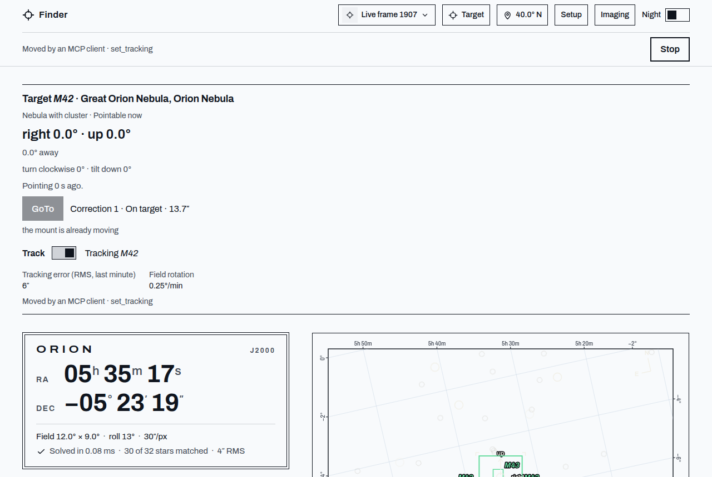
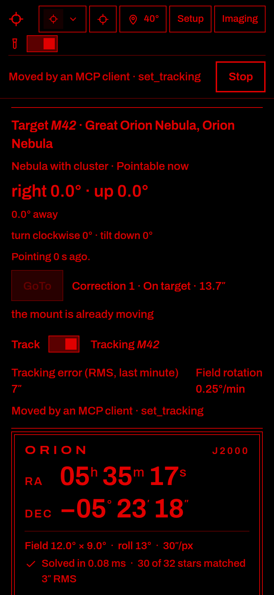

# plate-solver

[](https://github.com/bryantharpeorg/plate-solver/actions/workflows/ci.yml)

An electronic finder, GoTo and imaging controller for an alt-az GoTo telescope, built around a
fast star-field plate solver written in Rust.

A small camera on the finder scope takes a frame every second or so. Each frame is
plate-solved to the telescope's actual pointing, with no star alignment and no prior hint, in
a few milliseconds. From that the system:

- tells you which way to push the telescope;
- drives the mount to a target and corrects until it is there;
- tracks the target;
- runs an imaging camera at the focuser: focus, darks and flats, a live stack that follows the
  field's rotation, and one-button imaging runs.

You use it from a web page on a phone or laptop, or an AI assistant uses it over MCP.

<p align="center">
  
  
</p>

*The console on the simulator, tracking M42 after an AI assistant sent it there over MCP
([the session](#use-it-with-an-ai-assistant)). Left, a laptop in day mode; right, a phone in night
mode.*

Its plate solver re-implements [cedar-detect](https://github.com/smroid/cedar-detect) and
[cedar-solve](https://github.com/smroid/cedar-solve), the star detector and solver behind the
[Cedar](https://github.com/smroid/cedar-server) electronic finder, which build in turn on ESA's
[tetra3](https://github.com/esa/tetra3). Their authors deserve the credit for those algorithms
([prior work](#prior-work)). The rest is this project's own: the scope node, the pointing
model, GoTo and tracking, the imaging side, the page and the MCP server.

## Status

Working at one telescope, and looking for feedback.

- **Proven at the telescope:** the live finder, push-to and powered moves on the mount's own
  motors, on a Sky-Watcher 400P (16-inch) GoTo Dobsonian driven from a Raspberry Pi 3B+ with
  an Arducam OV5647 finder camera, 12 to 14 November 2026
  ([field report](docs/field/2026-11-13-first-light.md)). Track was used on a later night,
  20 November, for about 13 minutes at 14–24″ RMS ([field report](docs/field/2026-11-20-driveway-track.md)).
- **Simulator and CI only:** GoTo to a target, with no field GoTo on record yet, and full
  imaging runs.
- **Bench-proven:** a ZWO ASI071MC Pro imaging camera through INDI, including full frames
  received on that Pi.
- **Planned:** a Raspberry Pi 5 rig, which moves everything onto the telescope; a hands-free
  [voice mode](docs/voice/README.md), designed but not built.

[Known-good configurations](docs/hardware.md) has the details and the limits. If you use
Cedar, tetra3 or a SynScan mount, I'd especially like to hear how this works on your hardware
([feedback](#feedback-wanted)).

## What it does

- **Plate solving.** It gives cedar's answers on cedar's reference frames, and solves about 4×
  faster as a frame stream ([the solver](docs/solver.md)).
- **Live finder.** The chart updates with every frame. It shows where the telescope points,
  the matched stars as proof, what's in the field and what to look at next.
- **Push-to.** "Turn right 2.7°, tilt down 1.4°" to any of 13,000 objects from OpenNGC.
- **GoTo with no alignment.** Every solve taken while the mount is still is a sync, and a
  pointing model is fitted from them.
  GoTo corrects from fresh solves until it is within 60″.
- **Tracking.** Rates come from the pointing model, and live solves correct them. A push by
  hand is followed, not fought.
- **Imaging.** Any INDI camera. Each frame is saved as FITS, and ASTAP solves the subs and any
  frame you ask about. The page
  offers a focus aid, a calibration library and a live stack that is derotated sub by sub.
  Tracking can be steered from the subs. One button, or one MCP tool, runs the whole sequence.
- **Safety built in.** One Stop for everything. A watchdog stops the mount when the console goes
  quiet. Guards cover the Sun, altitude, cable wind and axis range.
  [Safety and security](docs/safety-and-security.md) also lists what isn't covered yet.
- **Night mode.** Red on black and dim, with no white flashes.
- **MCP.** 32 tools let an AI assistant observe and steer through the same guards as the page.

## How it fits together

Two programs run at night:

- **`scope-node`** runs on a Raspberry Pi riding on the telescope. It captures finder frames and
  finds their stars, drives the mount's two axes over USB serial, and relays the imaging
  camera's frames through INDI.
- **`finder`** (the console) runs on a laptop today. It solves, keeps the pointing model, plans
  GoTo, runs Track, and saves, solves and stacks imaging frames. It serves the page and MCP.

The planned Pi 5 rig runs both programs on the telescope and reaches them over an SSH tunnel.
[Architecture](docs/architecture.md) has the diagrams, the data flows and the plan.

## Get started

You need Rust 1.96 or later and `protoc` (Debian/Ubuntu: `sudo apt install protobuf-compiler`).
Run everything from the repository root. To try it, a shallow clone is enough:

```sh
git clone --depth 1 https://github.com/bryantharpeorg/plate-solver.git
cd plate-solver
```

**Solve sample frames** in the console, then open <http://127.0.0.1:8080>:

```sh
cargo run --release -p finder
```

**Run a whole simulated telescope**, with a finder camera, mount and imaging camera:

```sh
cargo run --release -p finder -- --simulate --sim-start 2026-01-16T02:00:00Z
```

**Solve one image from the command line:**

```sh
cargo run --release -p plate-solver --example solve_image -- \
    --db reference-solutions/cedar-solve/tetra3/data/default_database.npz \
    reference-solutions/cedar-solve/examples/data/medium_fov/orion_belt.jpg
```

The [quick start](docs/guide/quick-start.md) walks through all three, including a GoTo and an
imaging run on the simulator.

### Use it with an AI assistant

The console serves MCP (Streamable HTTP) at `/mcp`, on the page's port. With Claude Code, for
example:

```sh
claude mcp add --transport http finder http://localhost:8080/mcp
```

Every moving tool runs the page's guards, the page says when an MCP client is moving the
telescope, and the page's Stop ends any motion. The console listens on localhost by default,
and MCP calls from its own machine carry no token. With `--listen 0.0.0.0:8080`, every other
device must present the console token, a phone once through the console's prompt and an MCP
client as a bearer token, though any device can still stop the mount. See
[the console manual](docs/guide/console.md) and
[safety and security](docs/safety-and-security.md#network-exposure).

Here is a session with the simulated telescope. The tool calls and replies are real, shortened.

```text
> What's the telescope pointing at right now? Then take me to the Orion Nebula and keep it
  tracked.

● finder - get_pointing (MCP)
  ⎿  {"ra_deg":124.248,"dec_deg":29.685,"alt_deg":45.58,"az_deg":86.27,"source":"live",…}

● It's pointing at RA 8h 17m, Dec +29° 41′, in Cancer, 46° up in the east. The Orion
  Nebula is M42.

● finder - search_targets (MCP)(q: "M42")
  ⎿  [{"id":"NGC 1976","messier":"M42","common_names":["Great Orion Nebula","Orion Nebula"],
      "kind":"Nebula with cluster","mag":4.0,"class":"pointable",…}]

● finder - set_target (MCP)(target: "M42")
  ⎿  {"target":{"id":"NGC 1976",…},…}

● finder - get_guidance (MCP)
  ⎿  {"class":"pointable","separation_deg":52.34,"turn_deg":76.08,"tilt_deg":-2.47,…}

● M42 is up and pointable, 52° away. Starting the GoTo.

● finder - goto_target (MCP)
  ⎿  {"started":true}

● finder - get_session (MCP)
  ⎿  {"goto":{"state":"done","correction":1,"error_arcsec":16.09,…},…}

● finder - set_tracking (MCP)(on: true)
  ⎿  {"track":{"state":"armed","wanted":true,…},…}

● finder - get_session (MCP)
  ⎿  {"track":{"state":"tracking","readout":{"rms_arcsec":8.45,
      "field_rotation_deg_per_min":0.253}},…}

● You're on M42. The GoTo needed one correction and finished 16″ from the target, and
  Track is holding it to about 8″ RMS while the field turns 0.25° a minute. Say "stop",
  or press Stop on the page, to end it.
```

## Build one

[Parts lists](docs/parts-list.md) has what to buy, rough prices, and how the parts go together.

| Build | For | Status | Parts, about |
|---|---|---|---|
| Budget | The live finder, push-to, GoTo and Track, for visual observing: a Pi 3B+, a small camera with a 16 mm lens, and a USB cable to the mount | Proven at the telescope, except GoTo | $255–320 |
| Imaging | Everything above, plus a cooled imaging camera, a live stack and imaging runs, on a Pi 5 with an SSD and a UPS board | Planned: parts on order | $1,780–2,100 |

Both builds need a Sky-Watcher alt-az GoTo mount. Equatorial mounts are not supported yet.

## Documentation

| | |
|---|---|
| [Quick start](docs/guide/quick-start.md) | Everything on one computer, no hardware. |
| [Console manual](docs/guide/console.md) | Running the console for a real night: options, pairing, phones, ASTAP, MCP. |
| [Scope node manual](docs/guide/scope-node.md) | Putting the scope node on a Raspberry Pi. |
| [First night at the telescope](docs/guide/first-night.md) | The order of checks, and troubleshooting. |
| [A tour of the console page](docs/console-tour.md) | Every view and control. |
| [Architecture](docs/architecture.md) | The pieces, the links and the Pi 5 plan. |
| [Parts lists](docs/parts-list.md) | What to buy for a budget build or an imaging build, and how it goes together. |
| [Known-good configurations](docs/hardware.md) | Hardware that has run, its limits, and what else should work. |
| [Safety and security](docs/safety-and-security.md) | What stops the mount, and what is exposed on the network. |
| [The plate solver](docs/solver.md) | The command-line solver, pattern databases, and the comparison with cedar. |
| [First light](docs/field/2026-11-13-first-light.md) | The field report behind the "proven at the telescope" list. |
| [The first Track](docs/field/2026-11-20-driveway-track.md) | The field report from 20 November: Track, the finder's solve rate, and the network and power problems. |

[`docs/README.md`](docs/README.md) indexes everything else: the crate references, decisions,
research and specifications.

## Can I trust it?

Here is what backs it up, and where the gaps are.

**The solver is checked against cedar on every pull request.**

- CI solves cedar's 21 reference images three ways: from star positions, from pixels, and over
  gRPC. It compares every answer with cedar's own: identical star IDs within 5″ from star
  positions, and within 10″ with at least 90% of cedar's stars from pixels and over gRPC.
- A canary job then re-injects past bugs and nudges the goldens, to prove that gate still fails
  when it should. See [how correctness is checked](docs/solver.md#how-correctness-is-checked).

**Every change passes required checks before it merges.** There are 14:

- a change-detection job, and a manual brake (the `hold:human` label);
- formatting, Clippy with warnings as errors, and rustdoc;
- the minimum Rust version;
- unused dependencies;
- `cargo-deny` for advisories, licenses, banned crates and sources;
- a secret scan of every committed file;
- the parity gate and its canary;
- the page's checks: types, unit tests, the committed build matching its source, and browser
  tests against the release binary, including night-mode pixel checks;
- the full Rust test suite, on every pull request and again in the merge queue.

[`ENVIRONMENT.md`](ENVIRONMENT.md) says exactly what is enforced.

**The tests:**

- about 1,400 Rust tests, about 590 page unit and component tests, and about 30 browser
  end-to-end tests;
- end-to-end tests that drive the console's API against the simulator, through GoTo, tracking,
  Stop, imaging and MCP;
- an emulator for the mount's motor-controller protocol;
- recorded captures: the real finder camera's output, ASTAP's output, and an INDI exchange with
  INDI's camera simulator.

**What is not tested automatically:**

- No real mount or camera runs in CI. Hardware results come from bench and field nights, logged
  in [known-good configurations](docs/hardware.md) and the field reports
  ([first light](docs/field/2026-11-13-first-light.md), [the first Track](docs/field/2026-11-20-driveway-track.md)).
- The node stops the mount when it is stopped or shut down, but a crash or a power cut still
  ends it without a stop ([safety](docs/safety-and-security.md#what-does-not-stop-the-mount-yet)).
- The console asks other devices for a token but speaks plain HTTP, and no test pairs a phone
  over a real Wi-Fi. It listens only on localhost by default.

## How this repository is built

Since late October 2026, most of the code has been written by AI coding agents, driven by an
automated, spec-driven build system (configured by `ergane.yaml`).

1. **Spec.** Each feature starts as a specification in `specs/NNN-name/`: a spec, a plan and a
   task list.
2. **Review.** The maintainer reviews it and approves it in a pull request titled
   `specs NNN: flip … to ready`.
3. **Build.** The system builds it one user story at a time. Each story lands as its own
   squash-merged pull request titled `NNN-name/usN`, through the same required checks and merge
   queue as everything else.
4. **Ownership.** The maintainer owns the specs, the oracle files listed in
   [`.github/CODEOWNERS`](.github/CODEOWNERS), and the gates.

Earlier work, from June to October 2026, used the specifications under `openspec/`, and agents
directed by hand. The original v1 is kept at tag `v1-original`.

## Prior work

The plate solver re-implements published work. Its behaviour was defined by the projects below,
and their authors deserve the credit for the algorithms.

- **[TETRA](https://github.com/brownj4/Tetra)**: J. Brown, K. Stubis and K. Cahoy,
  ["TETRA: Star Identification with Hash Tables"](https://digitalcommons.usu.edu/smallsat/2017/all2017/124/),
  Proceedings of the AIAA/USU Conference on Small Satellites, 2017. The original hash-table
  approach to lost-in-space star identification.
- **[tetra3](https://github.com/esa/tetra3)** (European Space Agency; Gustav Pettersson): the
  lost-in-space solver this lineage is built on. Four-star patterns, edge-ratio hashing, the
  pattern database and its `.npz` format, and match verification. Apache-2.0.
- **[cedar-solve](https://github.com/smroid/cedar-solve)** (Steven Rosenthal): a fork of tetra3
  with lattice-field database generation, breadth-first pattern search, solve timeouts and
  status codes. This project's solver and database generator follow it. Apache-2.0.
- **[cedar-detect](https://github.com/smroid/cedar-detect)** (Steven Rosenthal): fast, robust
  star detection with noise estimation, binning, hot-pixel rejection and sub-pixel centroids.
  This project's `star-detection` crate reproduces its output exactly. FSL-1.1-MIT.
- **[Cedar](https://github.com/smroid/cedar-server)** (Steven Rosenthal): the plate-solving
  electronic finder that brings cedar-detect and cedar-solve together, and the closest existing
  system to what this project is for.

The imaging side relies on two programs it calls rather than links:

- **[INDI](https://indilib.org)**, which drives the imaging camera (LGPL-2.1-or-later).
- **[ASTAP](https://www.hnsky.org/astap.htm)**, which solves imaging frames.

Copies of cedar-solve (which carries its own fork of tetra3) and cedar-detect are kept in
[`reference-solutions/`](reference-solutions/), pinned to upstream commits and under their own
licenses, and CI checks this project's answers against them on every pull request.

This project is not affiliated with or endorsed by ESA or Steven Rosenthal. Cedar and Cedar Solve
are trademarks of Steven Rosenthal, named here only to describe where this work comes from.

## Repository layout

| Path | What it is |
|------|------------|
| `crates/star-detection` | Star detection: noise estimation, binning, sub-pixel centroiding and brightness. |
| `crates/math-core` | Shared numerics: unit vectors, the pinhole camera model, attitude (Wahba/SVD), FOV refinement. |
| `crates/pattern-database` | The pattern database: `.npz` loader, KD-tree and pattern lookup. |
| `crates/database-generation` | Builds pattern databases from star catalogs (Hipparcos, Tycho, BSC5). |
| `crates/plate-solver` | The solver (`solve_from_centroids`, `solve_from_image`) and the `solve_image` example. |
| `crates/grpc-service` | The `PlateSolver` gRPC service, as a library. |
| `crates/scope-link` | The protocol between the console and the scope node, its token check and its clock mapping. |
| `crates/scope-node` | The program on the telescope's Pi: finder camera, mount link and watchdog, imaging relay through INDI. |
| `crates/simulator` | The simulated finder camera, mount and imaging camera behind `finder --simulate`. |
| `crates/finder` | The console: web server, embedded React page (`web/`), API, MCP, pointing model, GoTo, Track and imaging. |
| `specs/` | One specification per feature from 012 on, which the build system builds from. |
| `openspec/` | The first-generation specifications, PRD and project conventions. |
| `docs/` | Guides, architecture, decisions (`adr/`), field reports (`field/`), research and CI reports. Start at [`docs/README.md`](docs/README.md). |
| `fixtures/` | Recorded captures from real hardware and programs, used as test oracles. |
| `reference-solutions/` | **The oracle**: vendored cedar-solve (with its fork of tetra3) and cedar-detect, with their sample images and databases. |
| `bench/cedar-compare/` | The benchmark against cedar-detect + cedar-solve. |
| `crates/scope-link/proto/`, `crates/grpc-service/proto/` | The gRPC contracts the build compiles. The root `proto/` holds older copies. |
| `scripts/`, `.github/workflows/` | CI, coverage and quality scripts. |

## Development

You need:

- **Rust 1.96 or later** and **`protoc`**. The console, the scope node and `grpc-service` all
  compile protocol definitions. If `protoc` can't find `google/protobuf/duration.proto`, also
  install `libprotobuf-dev`.
- **Node, only to change the page.** The page is built with Node in `crates/finder/web`, and its
  build is committed, so cargo never needs Node.

CI runs, among other checks:

```sh
cargo fmt --all --check
cargo clippy --workspace --all-targets --all-features --locked -- -D warnings
cargo nextest run --workspace --all-targets --all-features --locked
cargo test --workspace --locked --doc
```

The tests run under [cargo-nextest](https://nexte.st), which runs them in parallel across
test binaries (`.config/nextest.toml`). `cargo test --workspace --locked` runs the same tests
one binary at a time and needs nothing installed. Test builds are optimized
(`[profile.test]` in the root `Cargo.toml`) because the simulator's frames are slow without it.

There are two reports:

- **Coverage.** `scripts/coverage.sh` writes browsable coverage reports for the workspace and
  the page, with per-crate tables, to `target/coverage/`. [`docs/coverage.md`](docs/coverage.md)
  explains how to run and read them.
- **Code quality.** `scripts/quality.sh` writes a SonarQube-style report to `target/quality/`:
  complexity, duplication, lint findings by rule, panic paths, `unsafe` and advisories, with an
  A–E grade per crate and per file. [`docs/quality.md`](docs/quality.md) explains every figure.

## Feedback wanted

Especially:

- **Finder-scope frames:** raw frames or JPEGs from your finder camera, with the camera, the lens
  or finder, and its field of view, whether they solve or not.
- **Comparisons with Cedar or tetra3** on your own hardware, particularly a Raspberry Pi.
- **Other mounts:** whether the scope node's `--probe-mount` reads your Sky-Watcher motor
  board.
- **Failed or wrong solves:** the image and the command you ran.
- **Your rig:** the mount, finder camera and computer you would run it on, and what stops it
  working there.

Please open an issue.

## License

Licensed under either of

- Apache License, Version 2.0 ([`LICENSE-APACHE`](LICENSE-APACHE))
- MIT license ([`LICENSE-MIT`](LICENSE-MIT))

at your option.

The reference implementations vendored in [`reference-solutions/`](reference-solutions/) are not
covered and keep their own licenses: cedar-solve (with its tetra3 fork) is Apache-2.0, and
cedar-detect is FSL-1.1-MIT. They are test oracles only; none of their source is built into
this project's crates. The finder console's binary embeds third-party web packages and catalog
data, listed in [`crates/finder/THIRD_PARTY_NOTICES.md`](crates/finder/THIRD_PARTY_NOTICES.md)
and printed by `finder --licenses`.
[ADR-0003](docs/adr/0003-mit-or-apache-license-references-stay-oracles.md) records the decision.

Unless you explicitly state otherwise, any contribution intentionally submitted for inclusion
in this project by you, as defined in the Apache-2.0 license, shall be dual licensed as above,
without any additional terms or conditions.
