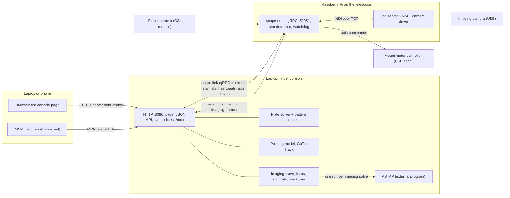
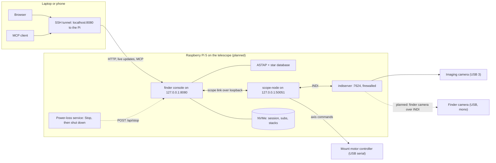

# Architecture

plate-solver is the software for an electronic finder and imaging controller on an alt-az
GoTo telescope. A small computer rides on the telescope and runs the cameras and the mount.
A console program does the thinking: plate solving, the pointing model, GoTo, tracking,
imaging and the web page. You use it from a browser, or an AI assistant uses it over MCP.

This page covers how the system is built today, then the Raspberry Pi 5 layout now being
planned. [Known-good configurations](hardware.md) lists the hardware it has run on, and
[safety and security](safety-and-security.md) covers what stops the mount and what is exposed
on the network.

## The pieces

| Crate | Job | Ends up in |
|---|---|---|
| `star-detection` | Finds stars in a frame: noise estimate, binning, hot-pixel rejection, sub-pixel centroids. Gives cedar-detect's output exactly. | `scope-node` (live frames) and `finder` (uploaded frames) |
| `math-core` | Shared numerics: unit vectors, the pinhole camera model, attitude (Wahba/SVD), field-of-view refinement. | `finder` and `database-generation` |
| `pattern-database` | Reads the `.npz` pattern database; KD-tree and pattern lookup. | `finder` |
| `plate-solver` | The lost-in-space solver (`solve_from_centroids`, `solve_from_image`) and the `solve_image` example. | `finder` |
| `database-generation` | Builds pattern databases from star catalogs (Hipparcos, Tycho, BSC5). | Its own command-line tool |
| `grpc-service` | The `PlateSolver` gRPC service, as a library. No server binary ships. | Tested in CI only |
| `scope-link` | The protocol between the console and the scope node (`scope_node.v1`), its bearer-token check and the heartbeat clock mapping. | Both binaries |
| `scope-node` | Runs at the telescope: finder-camera capture and star detection, the mount link and its watchdog, the imaging-camera relay through INDI. | The `scope-node` binary |
| `simulator` | A catalog-rendered finder camera, a two-axis mount, a 16-bit colour imaging camera and a virtual clock. | Linked into `finder` for `--simulate` |
| `finder` | The console: the web server and the embedded React page, the JSON API, live updates, MCP, live solving, the pointing model, GoTo, Track and imaging (save, solve, focus, calibrate, stack, run). | The `finder` binary |

Two programs run at night: **`finder`** (the console) and **`scope-node`** (on the telescope).
`database-generation` and the `solve_image` example are offline tools.

## How it runs today

**On the telescope, a Raspberry Pi runs:**

- `scope-node`, a gRPC server, on port 50051 by default.
- `rpicam-vid`, which `scope-node` starts for the CSI finder camera.
- `indiserver` with the imaging camera's INDI driver (for a ZWO camera, `indi_asi_ccd`), on
  port 7624.

**On a laptop, `finder` runs.** It listens on `127.0.0.1:8080` by default, or on
`0.0.0.0:8080` so a phone on the same network can open the page. It serves:

- the page;
- a JSON API;
- live reports as server-sent events (`/api/live`);
- an MCP endpoint (`/mcp`) with 32 tools.

For imaging solves it calls ASTAP's `astap_cli` as a separate program.

**Every browser and MCP client shares one observing session.** The same pointing state, target
and mount drive the page on a phone, the page on the laptop and an AI assistant at once.

### The links

| From → to | Protocol | What crosses |
|---|---|---|
| Browser → console | HTTP, with server-sent events for live reports | The page, API calls, JPEG previews |
| MCP client → console | MCP (Streamable HTTP) at `/mcp` on the same port | Tool calls |
| Console → scope node | gRPC over HTTP/2, a bearer token on every call except the emergency stop | Star lists from each finder frame, heartbeats, axis moves, camera settings |
| Console → scope node, imaging | A second gRPC connection for the imaging service only | Imaging frames in 256 KiB chunks |
| Scope node → INDI | INDI XML over TCP on the same machine | Exposures as FITS |
| Scope node → mount | Sky-Watcher's motor-controller protocol over a USB serial adapter, with no hand controller | Axis position, go to a position, move at a rate, stop |

The scope link is plaintext gRPC. The token proves the console is the paired one, but it is
not encryption: run the link on a network you trust. See
[safety and security](safety-and-security.md).

## Who owns what

Two decisions shape the split. Both are recorded as architecture decision records:

- **[ADR-0001](adr/0001-console-owns-pointing-scope-node-drives-axes.md): the console owns
  pointing, and the scope node only captures, detects and drives two axes.** Plate solving,
  the pointing model, GoTo, tracking and the page all live in the console.
  - The scope node never holds the pattern database. It sends star lists, not frames, so
    each finder update is a few kilobytes.
  - The console reaches hardware only through hardware-neutral ports. On the mount port each
    axis can report its position, go to a position, move at a rate, stop, and say what it can
    do.
  - Supporting another mount or camera means writing an adapter, not changing the logic.
- **[ADR-0002](adr/0002-imaging-cameras-through-indi-frames-relayed-console-stacks.md):
  imaging cameras come through INDI, the scope node relays their frames, and the console
  solves and stacks.**
  - Any camera with an INDI driver works with no per-model code.
  - The scope node does no pixel work. It forwards each frame untouched and can keep a copy.
  - The console saves every sub, solves it with ASTAP, calibrates it and stacks it.
  - The mount is not on INDI, because INDI's telescope interface works in sky coordinates
    and keeps its own alignment, which is what this project replaces.

**Finder frames are solved by this project's own solver**, on star lists the scope node
detected. **Imaging frames are solved by ASTAP**, behind a solver port that would accept
another solver.

## What happens when

### A finder frame becomes a chart

1. The scope node captures a gray frame, at up to 5 frames a second. It finds the stars with
   cedar's settings, and reads both axes' positions at the start and end of the exposure.
2. It streams a star frame to the console: up to 200 star positions, the axis readings and,
   when asked, a small JPEG preview.
3. The console keeps only the newest frame. It maps the node's clock to its own using the
   heartbeats.
4. It solves the star list against the pattern database. Each solve's field of view becomes
   the next solve's hint.
5. A solve sets the current pointing. When the mount is connected and still, the solve is also
   a sync: a sample for the pointing model.
6. The console pushes a live report to every open page, which redraws the chart and the
   push-to directions.

### GoTo

1. The page or an MCP client asks for a target.
2. The console checks its guards: a connected mount, a sync tonight, a target above the
   minimum altitude, the Sun down, the cable-wind and axis-range limits.
3. The pointing model turns the target into axis positions. The console sends a move to each
   axis, and the scope node drives the motors.
4. After the mount settles, the console waits for a fresh solve. Within 60″ the GoTo is done.
   Otherwise it corrects and tries again, up to five times.

### Track

1. Track needs a sync tonight, a site, the Sun down and a pointable target. A target more than
   1′ away starts with a GoTo.
2. Axis rates come from the pointing model. Live finder solves correct them through a feedback
   loop, with a keyhole near the zenith that an alt-az mount cannot follow.
3. A push by hand of more than 5′ is followed, not fought. Track holds the new place until you
   send it back.
4. During an imaging run with steering on, each sub's own solve measures the tracking error and
   steers Track. Corrections happen only between exposures.
5. Track ends safely and says why: Stop, the Sun guard, the minimum altitude, or a lost link.

### An imaging run

One button on the page, or one MCP tool, starts the same run. The console sequences it:

1. **Slew and track.** The run asks Track for the target, and Track does a GoTo first.
2. **First frame and focus check.** If focus is clearly soft, the run pauses for the observer,
   for up to 15 minutes.
3. **Solve and centre.** ASTAP solves an imaging frame. That measures where the imaging camera
   points relative to the finder, and the run re-centres the target, up to three tries.
4. **Stack.** Each sub is saved as FITS. It is then solved, checked, calibrated (dark, flat,
   bad pixels), debayered and placed on the first sub's grid using its own solve. The stack
   averages the subs with outlier rejection. The page shows a live preview of the stack.
5. **End.** The run stops with a stated reason, such as Stop, a guard, focus, or the time
   limit. It saves `stack.fits`, `stack.png` and `stack.json` in the run's folder, with the subs
   in `subs/` unless **Keep every sub** was off. Track stays on unless a guard or Stop ended it.

## Safety in the design

- **Heartbeat and watchdog.** The console sends a heartbeat every 250 ms. If the scope node
  hears nothing for one second, its watchdog stops both axes and refuses moves until the
  heartbeat returns. A returning heartbeat never resumes a move.
- **Stop.** The page's Stop button, the `stop` MCP tool and `POST /api/stop` all reach an
  emergency stop. That stop needs no token and retries for two seconds. The page tells you if
  the mount did not confirm it.
- **Guards.** Every move, from the page or MCP, goes through the same checks: Sun, minimum
  altitude, cable wind, axis range, and a rate limit for MCP.
- **Known gap.** Today the node has no shutdown handling. If the `scope-node` process stops,
  for example with `systemctl stop`, a reboot or a crash, the mount can keep moving. Press
  Stop and wait for the mount to be still before stopping the node, and keep the mount's power
  switch within reach. Spec 044 (the node stops the mount before it exits) will cover a clean
  stop, restart or shutdown. It is not built yet, and a crash or a power cut to the Pi will
  still leave the mount moving.

## The Raspberry Pi 5 plan (tentative)

The next rig moves everything onto one Raspberry Pi 5 on the telescope. This is a plan, not
something that has run yet.

Dashed lines are not built yet.

**Hardware.** The planned rig has these parts:

- A Pi 5 with an active cooler.
- A UPS HAT with an NVMe slot, so the Pi boots from an SSD instead of a microSD card.
- A metal case with a USB Wi-Fi adapter.
- A USB mono finder camera (a ZWO ASI120MM Mini with the same 16 mm lens, about 17° × 13°,
  inside the default database's 10–30° range).
- The same imaging camera, on USB 3.

[Known-good configurations](hardware.md#raspberry-pi-5-rig-planned) has the parts and what
each is expected to fix.

**What changes:**

- **The console runs on the Pi, next to the scope node.** Both are set to listen on localhost
  only. ADR-0002 already allowed for this: a stronger node could host the console itself.
- **You reach it through an SSH tunnel.** The laptop forwards a local port
  (`ssh -N -L 8080:127.0.0.1:8080 <pi>`), and the browser and MCP client use
  `http://localhost:8080` as before. With INDI's port firewalled (it binds every interface), only
  SSH is reachable from the network, and the node's pairing token never leaves the Pi.
- **Full imaging frames stay on the Pi.** Each frame is about 31 MiB from the ASI071. Only JPEG
  previews cross the Wi-Fi.
- **A Wi-Fi drop no longer stops the mount.** The heartbeat now runs over localhost. Track and a
  run carry on under the console's own guards while the page goes dark until the tunnel comes
  back. How to treat this is still an open decision.

**What stays:**

- The same two binaries and the same scope-link protocol.
- INDI for the cameras and ASTAP for imaging solves.
- The page, the API and all 32 MCP tools.
- ADR-0001's ownership split: the console owns pointing, the node drives the axes. Only where
  they run changes.

**Not built yet:**

- **The finder camera over INDI** (planned as spec 045). Today the scope node's finder camera
  can only be a CSI module through `rpicam`, or the simulator. Until this lands, the Pi 5 runs
  the existing CSI finder camera.
- **Stopping the mount when the node is stopped or shut down** (spec 044, not built yet).
- **A power-loss service** that presses Stop through the console and then shuts the Pi down.
- **Packaged install and deploy scripts.** Building and installing by hand is covered in the
  [scope node manual](guide/scope-node.md). The tooling that installs both programs on the Pi
  is not in this repository yet.

## Designed to change hardware

The ports and adapters exist so the telescope can change without a rewrite.

- **Cameras** come in through INDI or a camera adapter. Capabilities such as exposure range,
  gain, binning and cooler are read from the camera, and nothing is keyed to one model.
- **The mount** is reached through a two-axis port with one adapter today: Sky-Watcher's
  motor-controller protocol.
- **The imaging path is mount-neutral.** It touches the mount only through GoTo, Track, Stop
  and a tracking error stated on the sky. It takes each sub's rotation from that sub's own
  solve, and it is not sized to one focal length.

The pointing model and the tracker are alt-az. An equatorial mount, likely through INDI, would
be its own piece of design, and none of it is built.

## Where to read more

- [`crates/finder/README.md`](../crates/finder/README.md): the console's full reference, with
  every API route, setting, MCP tool and imaging behaviour.
- [`crates/scope-node/README.md`](../crates/scope-node/README.md): the scope node's reference,
  including the mount link and the INDI client.
- [`docs/adr/`](adr/): the architecture decisions.
- [`specs/`](../specs/): the specification for each feature as it was built, from 012 onward.
  See [how this repository is built](../README.md#how-this-repository-is-built).
- [`GLOSSARY.md`](../GLOSSARY.md): the project's terms (sync, aim point, sub, stack and others).
