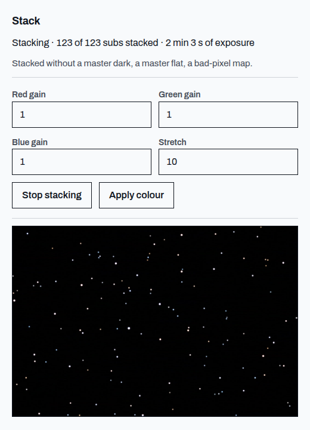

# Parts lists

There are two builds: a budget build for GoTo and tracking, and an imaging build. Each list says
what to buy and what has been proven, and shows how the parts go together.
[Known-good configurations](hardware.md) has the evidence behind each status, and the limits.

| Build | For | Status | Parts, about |
|---|---|---|---|
| [Budget: GoTo and tracking](#budget-goto-and-tracking) | The live finder, push-to, GoTo and Track, for visual observing | Proven at the telescope, except GoTo: no field GoTo on record yet | $255–320 |
| [Imaging](#imaging) | Everything above, plus an imaging camera: focus aid, darks and flats, a live stack and one-button imaging runs. The console runs on the telescope. | Planned. Parts on order; it has not run as a whole. | $1,780–2,100, about half of it the imaging camera |

**Prices** are rough US retail prices checked on 2026-11-21, rounded. Several came from search
listings rather than a store page, and Raspberry Pi and SSD prices were moving, so check before
you buy. The totals leave out the telescope, a laptop or phone, and anything marked "not counted".

## What either build needs

- **A Sky-Watcher alt-az GoTo mount** whose motor board speaks Sky-Watcher's motor-controller
  protocol. A 400P (16-inch) collapsible GoTo Dobsonian is the one tested. Other SynScan GoTo
  Dobsonians should work ([why](hardware.md#what-should-work-beyond-these-parts)). Equatorial
  mounts are not supported yet: the pointing model is alt-az.
- **A browser** on a phone or laptop, for the page.
- **The software**, all free:
  - this repository;
  - Raspberry Pi OS Lite (64-bit) with `rpicam-apps`;
  - for imaging, INDI (`indi-bin`, `indi-asi`) and ASTAP's `astap_cli` with its D50 star
    database.
- **Optionally, an MCP client** such as Claude Code, to steer by asking (see the
  [README](../README.md#use-it-with-an-ai-assistant)).

## Budget: GoTo and tracking

This is the rig every field night so far has used, without the imaging camera. A Raspberry Pi
on the telescope runs the finder camera and the mount. The console runs on a laptop beside it.

| Part | What to buy | About | Notes |
|---|---|---|---|
| Scope node | Raspberry Pi 3 Model B+ | $45 | Rides on the telescope. A Pi 5 gets no finder frames at the usual 1296 × 972 mode until spec 046 lands. |
| Pi power | A 5 V 2.5 A micro-USB supply, or a power bank and a short, thick cable | $10 | A weak cable undervolts the Pi. |
| Storage | SanDisk Max Endurance microSD, 64 GB | $45–60 | One card has failed at the telescope. Keep a flashed spare (not counted). |
| Finder camera | Arducam B0032 (OmniVision OV5647, CS mount) | $25–30 | Set its stock lens aside: its field, about 50°, is too wide for the default database. |
| Finder lens | Arducam 16 mm f/1.4 C-mount lens, with its C-to-CS ring | $65–110 | 13.0° × 9.75° on this camera, measured. That is inside the default database's 10–30°. |
| Mount cable | Sky-Watcher SynScan USB Adapter (S30107) | $30 | Plugs into the motor box's 6-pin RJ-12 hand-control jack. Not an RJ-45 "EQDIR" cable. |
| Housing | A plastic project box, about 160 × 110 × 90 mm (for example a LeMotech ABS box) | $35 | Plastic, because a metal box blocks the Pi's Wi-Fi. |
| Shoe foot | A Synta-style finder dovetail foot (an Astromania plate was used) | — | Slides into the telescope's finder shoe. Not priced. |
| Mount power | The mount's 12 V supply. A 12 V 5 A lithium power pack was used. | not counted | $220–260 if you need one. |
| Console | A laptop running Linux, or Windows with WSL2 | not counted | Runs `finder`. |

**Putting it together:**

1. **Fit the lens.** Thread the 16 mm lens, on its C-to-CS ring, onto the camera board.
2. **Box the camera and the Pi.**
   - Put the camera at the front of the box, with the lens out through the front wall.
   - Support the lens at its mount, not by the camera board: it weighs about 130 g.
   - Lay the Pi flat behind the camera, joined by the ribbon cable.
3. **Fit the foot.** Bolt the dovetail foot through the box floor, with wide washers, and slide it
   into the finder shoe.
   - You don't need adjusting screws. The console's aim point does the alignment in software:
     centre a star in the eyepiece, then tap it on the live photo (Setup, **Aim point**).
4. **Connect the mount.** Run the SynScan USB adapter from the Pi to the motor box's hand-control
   jack. The mount keeps its own 12 V supply.
5. **Focus on stars.** At night, focus the lens on stars and lock its ring.

Then put the software on the Pi with the [scope node manual](guide/scope-node.md), and follow the
[first-night checklist](guide/first-night.md).

## Imaging

*The Imaging page's live stack on `finder --simulate`. Its camera renders stars only.*

The imaging build moves both programs onto a Raspberry Pi 5 on the telescope. That keeps full
imaging frames off the Wi-Fi, and a UPS board rides out a bumped power cable.
[Architecture](architecture.md#the-raspberry-pi-5-plan-tentative) shows the layout.

**Status.** The parts are on order, and the build has not run as a whole.

- **Proven:**
  - the imaging camera, on a bench and on the Pi 3B+;
  - the 16 mm lens.
- **Not built yet:**
  - the ASI120MM Mini as the finder camera (spec 045, the finder over INDI);
  - the Pi 5's camera frames (spec 046), needed only if you keep the OV5647 finder;
  - the power-loss service;
  - the install tooling.

**On another telescope.** The imaging side isn't tied to the 400P.

- It reads the camera's sensor, gain, binning and cooler from the camera itself.
- It solves each sub for its scale and rotation.
- It needs the focal length only until a scale is measured, and only when the imaging frame is
  under 0.3° tall, the smallest field ASTAP searches for by itself. Give it then with
  `--focal-length-mm`.

The mount is what limits the choice: it must be a Sky-Watcher alt-az GoTo mount, as above. On an
alt-az mount the field turns during an exposure, so each sub is short. The live stack turns each
sub back before adding it, and the page shows the longest exposure that stays sharp.

| Part | What to buy | About | Notes |
|---|---|---|---|
| Computer | Raspberry Pi 5, 8 GB | $175–200 | Runs the scope node and the console. 8 GB leaves room for a full-frame stack. |
| Pi supply | Raspberry Pi 27 W USB-C power supply | $15–20 | Plugs into the UPS board, not the Pi. |
| Cooling | Raspberry Pi Active Cooler | $15 | The case below takes this cooler only. |
| UPS and SSD board | Geekworm X1208 | $50–60 | One 21700 cell, an M.2 NVMe slot, a power-loss signal, and power-on by itself. |
| Battery cell | Samsung 50E 21700, flat top, unprotected | $6–9 | For the X1208. |
| SSD | An M.2 2280 NVMe SSD, 500 GB or more | $100–150 | The Pi boots from it, and frames go to it. A full ASI071 sub is about 32 MB. |
| Case | Geekworm X1207-C1 metal case | $15 | For a Pi 5 with the X1208. |
| Wi-Fi | TP-Link Archer T3U Plus USB adapter | $28–32 | The metal case weakens the Pi's own antenna. It should work with Linux's own driver; untested. |
| Finder camera | ZWO ASI120MM Mini | $180–200 | Mono, 1280 × 960, USB 2. About 17° × 13° on the 16 mm lens. Needs spec 045. |
| Finder lens | The Arducam 16 mm f/1.4 C-mount lens, as above | $65–110 | The camera's 4 mm M28.5-to-CS adapter (in the box) and the lens's 5 mm C-to-CS ring set the lens at its 17.5 mm. |
| Finder holder | A rigid holder with a dovetail foot | — | A 3D-printed design is in progress and not published yet. |
| Imaging camera | ZWO ASI071MC Pro, or any INDI camera that sends FITS | $900–1,000 | Cooled colour camera. Use a USB 3 cable: the one used so far linked at USB 2. |
| 12 V power | A 12 V lithium pack for the mount and the camera's cooler | $220–260 | A Celestron PowerTank Lithium Pro was used. |
| Pi power in the field | A 12 V to 5 V 5 A USB-C PD converter | $10–25 | Not chosen yet. It must offer 5 A over USB-C PD, or the Pi limits its USB ports. |

**How it goes together (planned):**

- **The Pi** sits in its case on the rocker box. USB cables run up to the imaging camera and the
  finder camera, and the mount cable goes to the motor box.
- **The finder camera** sits in its holder in the finder shoe, and is aligned in software as in
  the budget build.
- **The 12 V pack** powers the mount and the camera's cooler. Connect the camera's 12 V before
  its USB. The converter feeds the X1208, and the cell carries the Pi through a bumped cable.

Install tooling for the Pi isn't in this repository yet. The
[scope node manual](guide/scope-node.md) covers the node by hand, and the
[console manual](guide/console.md) covers the console and ASTAP.
