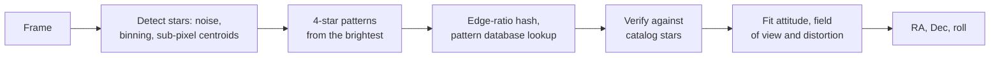

# The plate solver

At the core of the project is a fast lost-in-space plate solver in Rust. Give it a frame from a
camera on the telescope's finder and it works out where the telescope points: right ascension,
declination, roll and field of view. It needs no prior pointing information, and a solve takes
a few milliseconds.

It re-implements [cedar-detect](https://github.com/smroid/cedar-detect) and
[cedar-solve](https://github.com/smroid/cedar-solve), which build on ESA's
[tetra3](https://github.com/esa/tetra3). The README's
[prior work](../README.md#prior-work) section credits them.

## How a solve works

Solving follows tetra3 and cedar-solve:



Detection is the `star-detection` crate, the database `pattern-database` (and
`database-generation` to build one), the shared numerics `math-core`, and the solve itself
`plate-solver`.

## Solve an image

```sh
cargo run --release -p plate-solver --example solve_image -- \
    --db reference-solutions/cedar-solve/tetra3/data/default_database.npz \
    reference-solutions/cedar-solve/examples/data/medium_fov/orion_belt.jpg
```

```text
reference-solutions/cedar-solve/examples/data/medium_fov/orion_belt.jpg: MATCH_FOUND  RA 84.0081  Dec -0.7690  Roll 2.54  FOV 10.15 deg  k -0.003  matches 24  RMSE 34"  (26 stars, detect N ms, solve N ms)
  sky map: https://aladin.cds.unistra.fr/AladinLite/?target=84.0081%20-0.7690&fov=12
```

Reading the output:

- **RA, Dec, Roll and FOV** are in degrees.
- **`k`** is the fitted radial distortion; negative is barrel.
- **RMSE** is the residual over the matched stars, in arcseconds.

Pass several images to solve them in one run; the database loads once. PNG, JPEG, BMP and PNM
files are read.

**Frames are read the way cedar reads them.**

- Colour turns gray with PIL's weights (`star_detection::gray`).
- Stars are detected with cedar's settings (`DetectParams::cedar()`: 2 × 2 binning, rows
  levelled, hot pixels rejected).
- On cedar's 21 sample frames that gives cedar's answer, to within 4.2″, on all 20 frames cedar
  solves.
- That is looser than the 0.0005″ in [the comparison](#how-it-compares-with-cedar) only
  because the Rust `image` crate and PIL decode JPEGs slightly differently. Given the same
  pixels, the answers agree.

**The database must cover your camera's field of view.** The cedar database used above covers
10–30°, so build one for any other field (below).

| Flag | Default | Meaning |
|------|---------|---------|
| `--db PATH` | required | Pattern database (`.npz`): one built below, or a cedar/tetra3 database. |
| `--fov DEG` | none | Horizontal FOV estimate. Leave it off for the first solve: a wrong hint with a tight `--fov-max-error` prevents solving. |
| `--fov-max-error DEG` | 10 | How far the true FOV may be from `--fov`. |
| `--distortion K` | 0 | Radial distortion `k` from an earlier solve with the same lens. Speeds up and steadies wide-field solves. |
| `--bin N` | 2 | Bin the image by 1, 2, 4 or 8 before detection. |
| `--sigma S` | 8 | Detection significance threshold. |
| `--stars N` | 30 | Number of brightest detected stars passed to the solver. |
| `--dark PATH` | none | Dark frame (lens capped, same exposure and gain) subtracted before detection. Removes hot pixels. |
| `--timeout MS` | 5000 | Solve timeout in milliseconds. |
| `--json` | off | Print one JSON object per image instead of text. |

## Build a pattern database

```sh
cargo run --release -p database-generation -- hip_main.dat hip_30_60.npz --min-fov 30 --max-fov 60
```

**Bracket your field.** Set `--min-fov` and `--max-fov` (in degrees) around your camera's
horizontal field of view.

**Pick a catalog deep enough for it.** Following tetra3's guidance:

- The Hipparcos main catalog, `hip_main.dat` (53 MB), suits fields down to about 10°.
- The Tycho catalog, `tyc_main.dat`, suits fields down to about 3°.
- Both are in the CDS catalog [I/239](https://cdsarc.cds.unistra.fr/ftp/I/239/).
- A BSC5 file also works for wide fields.

The catalog type is detected from the file name (`hip`, `tyc` or `bsc5`). `--help` lists the
other options: magnitude limit, proper-motion epoch and pattern density.

**To try it without downloading anything,** build from the BSC5 catalog vendored for cedar's
tests (32 MB of output):

```sh
cargo run --release -p database-generation -- reference-solutions/cedar-solve/tests/data/bsc5 bsc5_10_30.npz --min-fov 10 --max-fov 30
```

## How it compares with cedar

**Method.** The comparison runs cedar's open-source pipeline the way cedar-solve's example
script runs it:

1. Python decodes each frame.
2. It calls `cedar-detect-server` over gRPC, with shared memory.
3. It solves with cedar-solve.

Both sides used:

- the same 21 sample images;
- the same settings: sigma 8, 2 × 2 binning, the brightest 30 stars, no field-of-view hint;
- the same 10–30° pattern database.

**Answers.** Both solve 20 of the 21 images. Given the same decoded pixels, they find the same
stars and return the same solution on all 20: positions agree within 0.0005″, with identical
matched catalog stars.

**Speed, as a stream of raw camera frames** (one frame at a time, one core). Each row is how
many times faster plate-solver is:

| Per frame | plate-solver vs cedar-detect + cedar-solve |
|---|---|
| Sustained rate | about 4× faster |
| Median frame | about 2× faster |
| 90th percentile | about 4.5× faster |
| Slowest frame | about 12× faster |

Where the difference comes from:

- **Finding stars:** the same algorithm at the same speed in-process. cedar's pipeline adds a
  gRPC call from Python to the detector for every frame, which costs about half as much again
  as detection itself.
- **Solving:** about 40× faster at the median. cedar's slowest frames come from here.
- **Start-up:** about 6× faster. The difference is mostly Python and NumPy imports, paid once
  per process.
- **JPEG frames:** about 1.5× faster. Decoding dominates on both sides, so raw frames avoid it.

**Limits of these numbers:**

- **One machine.** It was a 64-bit ARM laptop, so treat the ratios as more portable than any
  absolute time.
- **Not finder frames.** These are cedar's 10–30° sample images, 0.3–2.1 megapixels.
- **No hints.** Every frame is solved from scratch. A live stream passes the previous frame's
  field of view to the next solve, which speeds up both solvers and would likely narrow the gap.
- **Cedar's components, not the Cedar product.** This measures cedar-detect and cedar-solve as
  open-source components, not the Cedar product on its own hardware.

**Reproduce it** on your own hardware with [`bench/cedar-compare/run.sh`](../bench/cedar-compare/).
Its README covers the prerequisites.

## How correctness is checked

"Correct" means agreeing with cedar. CI's `e2e-eval` job solves the 21 sample images in
`reference-solutions/cedar-solve/examples/data/medium_fov/` three ways, and compares every
answer with cedar's:

- **E1**, from star positions: the same status, identical star IDs, within 5″, with and without
  a field-of-view hint.
- **E2**, from pixels: within 10″.
- **E3**, over the gRPC service.

`e2e-canary` proves that gate can still fail. It applies ten deliberate nudges and re-injects
five previously fixed bugs, each alone, and each must turn the right tier red.
[`ENVIRONMENT.md`](../ENVIRONMENT.md) lists what CI enforces and which files define "correct".
