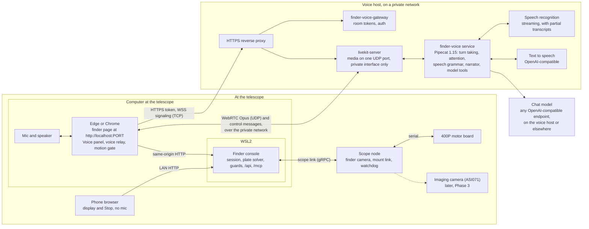
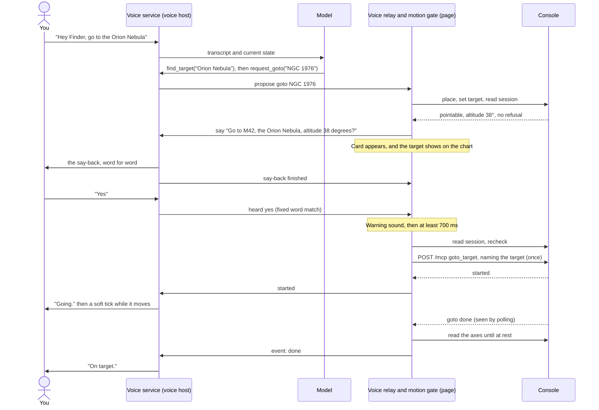

# a. Architecture

## 1. The shape of it

The computer at the telescope captures your voice and plays the assistant's. The audio travels over a private network to the voice service on a voice host, which does the listening, thinking and speaking. When the assistant needs the telescope, it asks the page, and the page asks the console. The console keeps every guard it already has.

The page is the only route from the voice service to the telescope. That one choice keeps `/mcp` closed to other networks, gives voice a natural dead-man switch, and adds no new program to the Surface.

## 2. Where each piece runs

| Piece | Runs on | New or existing | Owns |
|---|---|---|---|
| Voice panel | Page, on the Surface | New | The on/off control, what it heard, the say-back card, Yes and No |
| Voice relay | Page, on the Surface | New | The only route to the console. An allow-list of calls |
| Motion gate | Page, on the Surface | New | The one pending move, its checks, and the single motion call |
| Finder console | WSL2 on the Surface | Existing, small additions | The observing session, every guard, Stop |
| Scope node | Raspberry Pi on the telescope | Existing, unchanged | The axes and the 1 s heartbeat watchdog |
| finder-voice service | Voice host | New, own repository | Turn taking, the attention window, speech grammar, conversation, narration |
| finder-voice-gateway | Voice host | New, own repository | Minting a LiveKit room token for an allowed person |
| livekit-server | Voice host | New, shareable | WebRTC media and the control channel |
| STT, TTS | Voice host GPU | New, shareable | Speech to text, text to speech |
| Chat model | Voice host or elsewhere | Supplied by you | Any OpenAI-compatible endpoint with streaming and tool calls |

The phone stays a display and a Stop button. Browsers only allow the mic on a secure page, and the console serves plain HTTP, so `http://192.168.x.x:PORT` can't reach a mic while `http://localhost:PORT` can. The panel checks `window.isSecureContext` and hides the voice control when it's false.

### Part of the page, not beside it

The voice service is a separate program in its own repository, but everything you see and touch belongs to the finder page. There is no second app or window, and voice uses the page's own components, its day and red-only night styles, and the glossary's words.

| Where | What voice adds |
|---|---|
| Top bar (`TopBar`) | A Voice control beside the existing ones: off, listening, or a problem. One tap starts it |
| Setup (`SetupPage`) | A Voice group beside the MCP section: service URL, access token, wake phrase, and a Test button |
| Main page | A Voice section in the page's normal flow: state, what it heard, what it's saying |
| Say-back card | The page's own sheet, with large Yes and No buttons |
| Chart | A proposed target shows on the chart like any other target |
| Stop (`StopButton`) | The page's own button runs the same Stop sequence |
| Move note (`McpNote`) | Reads "Moved by voice" on the page that started the move |

**The voice profile keeps the telescope's side in this repository.** Tool definitions, the model's instructions, the word lists, the fixed sentences and the pronunciation rules ship with the page as one versioned file, and the service loads them when the page connects. So all of it is reviewed and tested here, without the speech stack, and the service itself stays a general voice runtime that anyone can host.

## 3. Decisions and the alternatives

### Who reaches the console

| Option | Result |
|---|---|
| **The page relays (chosen)** | No new exposure. The page is already beside the console, already holds the mic, and is the natural place for a dead-man rule |
| The voice service calls `/mcp` | Refused today for a host outside the LAN. `/mcp` accepts only loopback, RFC 1918, link-local and unique-local peers, so VPN addresses such as 100.64.0.0/10 are refused. Allowing them would weaken 016's FR-003 |
| A small relay program on the Surface | Another program to install and keep running, for no gain over the page |

### Audio transport

| Option | Result |
|---|---|
| **Self-hosted LiveKit pinned to the private interface (chosen)** | One UDP port, nothing on other networks, and fast automatic reconnect. Costs a server to run and a `livekit-client` dependency in the page, loaded only when voice starts |
| Pipecat SmallWebRTC | No server, but its stock web client pulls a bundle from Daily's CDN, so it needs a custom media manager or its own page client. It also binds random UDP ports on every interface including the LAN, needs broad firewall openings, and takes 5 s or more to recover. That matters more here because the control channel carries Stop. Kept as the fallback if LiveKit fails the proof of concept |

### Where the wake phrase is heard

Pipecat 1.15 has `WakePhraseUserTurnStartStrategy`, which works from the transcript. Speech recognition has to run all the time anyway so that "Stop" works without a wake phrase, so a separate keyword model would add a second thing to run and train. openWakeWord stays as the fallback if transcript-based waking fails the far-field test.

### Where the confirmation lives

The model never confirms anything. A request from the model only opens a say-back. The yes comes from a fixed word match on the transcript, or a tap on the card. See [Safety](03-safety.md).

## 4. How a move flows

Stop takes a shorter path. The service sees the word in a partial transcript and tells the page, and the page sends `POST /api/stop`, with no model involved. The page repeats it until the mount's own reading shows rest, and only then does the assistant say so.

## 5. Trust boundaries

| Layer | Trusted to | Not trusted to |
|---|---|---|
| Model | Understand a request, choose a tool, talk about the sky | Move anything, confirm anything, or report a move that the console didn't report |
| Voice service code | Match "yes", "no" and "Stop" exactly as written, speak say-backs word for word | Decide whether a move is safe |
| Voice relay and motion gate | Allow only listed calls, hold one move, recheck before acting | Override the console |
| Console and scope node | Every physical guard, as today | |

The console can't tell a voice-started move from any other MCP call, and it doesn't need to. The move passes the Sun guard, the minimum altitude, the cable rule, the mount range checks, the rate limit and the watchdog like every other. The page shows "Moved by an MCP client · goto_target", and the call log records it.

## 6. What does not change

- ADR-0001 stands: the console owns pointing and the scope node drives the axes.
- `/mcp` keeps its Origin, Host and LAN-peer checks.
- There is no MCP on the scope node.
- The page works exactly as it does today when no voice service is set.
- With no internet, or with the voice host off, everything except voice still works. Voice joins Aladin survey imagery as an optional online extra.

## 7. Prerequisites that don't exist yet

Any telescope test needs these first, and voice depends on them too.

1. The console has never been run on the Surface. All bring-up so far ran it on another machine.
2. The Surface needs a steady route to the voice host.
3. `scope-node` has never been installed on the Pi.
4. The Pi isn't on the site's Wi-Fi yet. The network is a setting, so any will do.
