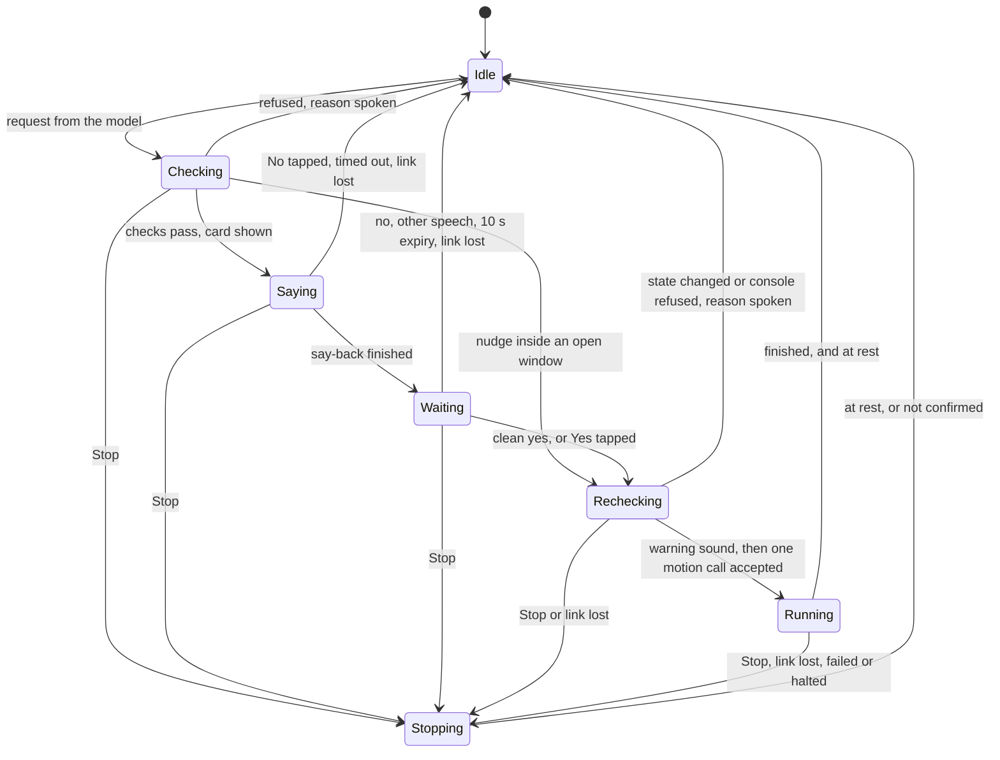

# c. Safety rules

The telescope is a 16-inch Dobsonian that moves on its own in the dark, near a person whose eye is at the eyepiece. Speech recognition makes mistakes and language models make things up, so neither is allowed to be the thing that decides a move happens.

## 1. Principles

1. **The model can only ask.** No tool available to the model moves the telescope.
2. **A move needs a clean yes, in fixed code.** Say-back and yes are matched by written rules, not by a model. The one exception is the nudge window in section 3, where a yes to a nudge also covers small follow-up nudges for 20 s.
3. **Stop is never behind the model, the wake phrase, or a confirmation.**
4. **Nothing is loosened.** Every move passes the same console guards as any other MCP call. Voice adds checks and removes none.
5. **Failure stops motion.** If voice can't hear you, a voice-started move doesn't keep going.
6. **One move at a time, once.** A move is never queued, and a failed move is never retried by itself.
7. **"At rest" needs evidence.** A reply from the console doesn't prove the axes stopped. Only the mount's own reading does.

## 2. What could go wrong

| # | Hazard | Controls |
|---|---|---|
| H1 | The model invents a move, or claims one happened | Model tools can only ask. Outcomes are spoken from what the console reported. The system prompt forbids claiming a move, and code doesn't depend on that |
| H2 | A target is misheard | The say-back names it, and the chart shows it, before the yes |
| H3 | A false yes: echo, noise, a bystander | Section 4 |
| H4 | "Stop" isn't heard, or arrives late | Section 5. Heard without a wake phrase, acted on from the partial transcript. The tick plays only while the whole path, mic included, is alive |
| H5 | The link drops during a move | The dead-man rule, section 6 |
| H6 | The Surface sleeps or crashes during a move | If the console stops, heartbeats stop, and the scope node's watchdog stops the axes after 1 s (`crates/scope-node/src/mount/watchdog.rs`). Sleep itself is unproven, so Phase 0 tests it |
| H7 | An old request acts later | One pending move, a 10 s reply window, single-use ids, a recheck right before acting |
| H8 | The state changes between asking and yes | The recheck, per kind of move (section 3). The GoTo call names the confirmed target |
| H9 | A nudge goes the wrong way | The say-back states the direction in Turn and Tilt terms, and inside the nudge window the assistant states it as it starts. Fixed sizes, at most 1° |
| H10 | The assistant reports stale pointing as current | `where_pointing` carries its age and `stale`, and the assistant says so |
| H11 | Someone else reaches the voice service | The private network, an access check, a room token, and the page's check of who sent each message. See [Deployment](05-deployment.md) |
| H12 | Text from a tool or catalog tells the model to do something | The model still can only ask, and a person still has to say yes |
| H13 | Daylight, cable wind, low altitude, mount limits | Existing console guards, unchanged: the minimum altitude (default 15°), the Sun guard, cable wind held to one turn either way, and the mount's range checks |
| H14 | Something or someone is in the telescope's path | Not detectable. The say-back states a long swing, a warning sound comes before motion, the tick marks motion, and Stop is always available |
| H15 | A Stop and a starting move cross | Stop wins from any state, and a move that slipped through is stopped again (section 5) |
| H16 | A stop never reaches the mount's motor board | The page repeats Stop until the mount reads at rest, and only then says so (section 5). The console's own Stop is one attempt (R21) |
| H17 | Track swings the telescope hours after the yes | Near the zenith, Track stops and slews to where the target comes out, up to about 180° of Turn at full speed. The narrator warns ahead and says it's moving, and the tick plays |
| H18 | The scope node itself dies | No watchdog is left to end a move. The assistant says the telescope may still be moving. Nudges are position moves, which end by themselves |

## 3. The motion gate

The gate is fixed code in the page. It holds at most one proposed move.

`Stopping` is the Stop sequence in section 5.

**Rules**

- A new request while another is pending is refused, not queued. `choose_target` is refused too, unless the gate is Idle.
- The service refuses a new proposal unless you've spoken since the last one ended. A spoken "no" or "skip" counts. So a prompt that expired isn't asked again on its own, and a tour doesn't open a prompt unbidden after you arrive.
- Declining or expiry restores the target that was set before the request.
- The say-back can't be talked over. During it only Stop acts, and other speech is ignored. If playback hasn't finished within 10 s, the move is cancelled.
- A yes plays a short warning sound straight away, from the page, so it needs no network. The motion call goes out no sooner than 700 ms later. The first sign of motion is never the motion itself, and a quick "wait" still catches it.
- The gate accepts at most one motion start every 2 s, and none for 3 s after a Stop.
- The motion call is made exactly once. The gate tests `result.isError`, because the console answers a refusal with HTTP 200. If the call fails, the reason is spoken and the gate returns to Idle.
- A GoTo names the confirmed target ([C7](02-tool-contracts.md#5-console-and-page-additions)), so a tap on the phone in that last moment can't redirect it. After Track starts, the page compares `track.target.id` with what you confirmed, and stops on a mismatch.
- The card stays on screen throughout, in red-only night style, with large Yes and No buttons. A tap counts the same as speech.

**The recheck** reads the session right before the motion call. It differs by kind of move, and all three must also pass the last row.

| Kind | Must be true |
|---|---|
| GoTo | Same target id. `goto_refusal` absent. Track off. Mount connected and not moving. No GoTo or direct move running |
| Track | Same target id, still `pointable`. Track off. Mount connected and not moving. No GoTo or direct move running |
| Nudge | Track off. Mount connected and not moving. No GoTo or direct move running. A fresh axis position has been read |
| All | Voice link healthy. No Stop since the yes |

`goto_refusal` is checked only for a GoTo, because the console also sets it when no target is chosen, which a nudge doesn't need. Mount connected is checked separately, because `goto_refusal` is absent when the mount is disconnected.

**When Running ends.** A GoTo or nudge ends when the console reports it finished and two mount readings show both axes at rest. Track ends when it reaches `tracking`. A `failed` or `halted` report goes to Stopping first, because the console saying it halted doesn't prove the axes did.

**The nudge window.** A yes to a nudge opens a 20 s window, counted from the yes and not extended by later nudges. Inside it, a further nudge of the same size or smaller skips the say-back and the wait. The assistant says what it's doing as it starts ("Tilting up a quarter degree."). Everything else still applies: the request needs fresh speech from you, the recheck runs, the warning sound and 700 ms pause come first, and there's at most one motion start every 2 s, so a window can move the telescope about 10° at most. A larger nudge asks again, and a yes to it opens a new window at that size. The window closes early on any Stop, a refused or failed nudge, a proposal of any other kind, or the voice link failing.

## 4. What counts as yes

The voice service compares the **whole final transcript** of one utterance, with fillers removed, to a short list.

| Verdict | Accepted utterances |
|---|---|
| `yes` | "yes", "yes please", "confirm", "affirmative" |
| `no` | "no", "nope", "cancel", "don't", "do not", "never mind", "wait" |
| Stop | The Stop words in section 5 (also cancels) |
| `other` | Anything else. **Cancels the move.** "Yes but wait" is `other` |

"Go", "go ahead", "do it", "yeah" and "yep" aren't on the list. Each sounds close to a word with the opposite meaning, or is easily said to someone else: "go" and "no", "do it" and "don't", "yep" and "nope".

**Keeping the assistant from confirming itself.** The mic stays open while the speaker plays, so:

1. No fixed sentence contains a yes word, a Stop word or the wake phrase. That covers say-backs, the narrator and the reason table. A test checks every template against the word lists, and every common name in the catalog as well.
2. Only speech that **starts after** the say-back has finished playing, plus 400 ms and the measured audio round trip, can count. Speech that starts sooner is ignored. It neither confirms nor cancels.
3. **Nothing else can be spoken while a move is pending.** A fixed gate at the speech engine's input passes only the exact `prompt` text, and drops anything from the model. The `request_` tools also end the model's turn in code.
4. The browser's echo cancellation stays on, and capture and playback run for the whole session so that it stays converged.

**Other limits.** The reply window is 10 s after the say-back. The wake phrase isn't needed for the answer, since the window is only open right after a prompt. New moves are refused on a fallback speech recogniser, because they fall outside what was tested and some produce text from noise. There is no voice identification, so anyone within earshot can say yes. This is accepted for a private site.

## 5. Stop

| | |
|---|---|
| **Stop words, always** | "stop", "stop it", "stop stop", "abort", "halt", "emergency stop", as the first words of an utterance, with or without the wake phrase |
| **Motion watch** | During a GoTo, a nudge, an armed Track or a keyhole slew, and for 5 s after any yes, any of "stop", "halt", "abort", "whoa", "wait", "no" or "hold" **anywhere** in an utterance counts as Stop |
| **Acts on** | The first partial transcript that shows the word. It doesn't wait for you to finish |
| **Path** | Voice service, then `stop` message, then the page. No model, gate or wake phrase involved |
| **Other ways in** | The page's Stop button, `track_off`, the model's `stop_telescope` for other wordings, the dead-man rule, and turning voice off during a move |
| **Budget** | Start of the word to the first `POST /api/stop` sent: P50 ≤ 900 ms, P90 ≤ 1.5 s. Then the console's stop path and the mount's deceleration, about a second from full speed |
| **Independent of voice** | The page's Stop button, on the Surface or the phone, and the mount's power switch. Voice Stop needs the Surface's mic, the link and the voice host |

**Every Stop does the same thing, in this order:**

1. Adds one to the page's stop counter and takes the gate out of whatever it was doing. This comes first, before anything is sent.
2. Cuts off speech and plays a short acknowledgement sound.
3. Sends `POST /api/stop`, whatever the page believes is moving, and repeats it every 300 ms.
4. Reads the mount with `get_axis_state` each time. When two reads in a row show both axes still, it says **"At rest."** An error from that read is not evidence.
5. After 5 s without that, it says locally, **"Can't confirm the telescope is at rest. Use the power switch."** If the page never saw a mount connected, it says "No mount is connected" instead.
6. Waits for any motion call already sent. If that call reports started, or can't report at all, steps 3 to 5 start over.

**Why it repeats.** The console's Stop makes one attempt with a 200 ms limit, and answers `{"stopped": true}` whatever happened (`crates/finder/src/api.rs:773`). A stall on the scope node's Wi-Fi shorter than the 1 s watchdog can lose it while heartbeats look healthy, and the mount then runs on. A Stop that arrives just before a motion call also doesn't cancel that call, because the call samples its stop generation after it starts. The page has to cover both. See R21.

**False Stops.** A sentence that begins with "stop" fires it, and so does a stray "no" during a slew. This errs in the safe direction, so the lists lean toward firing. False Stops are counted in Phase 0. During steady tracking only the always-on Stop words apply, since hours of conversation would otherwise end it.

**Echo.** Fixed sentences contain no Stop words, and the speech filter removes them from anything the model says, so the assistant can't trigger Stop by speaking. Words such as "no" and "wait" can't be kept out of speech, so a motion-watch word is ignored while the sentence being spoken contains it.

**Residual risk.** A Stop from the phone reaches the console but not the gate. If it lands in the moment between the recheck and the motion call, the move still starts. The warning sound, the tick and the phone's own Stop button all show it, and a second Stop ends it.

**The tick.** While voice-started motion or a keyhole slew runs, the service plays a soft tick every 2 s, and only while it's receiving fresh mic audio and recognition is keeping up. It proves the whole loop from mic to speaker, so **if the ticking stops, don't rely on voice.**

## 6. Disconnects

The **dead-man rule**: if the voice link fails while voice-started motion is running, the page runs the Stop sequence.

**Voice-started motion** means a GoTo or nudge the relay started, or Track the relay armed, until it reaches `tracking`. A GoTo that Track starts is a full-speed slew, so it counts. A voice-link blip can't stop a GoTo you started by hand.

The rule is a condition, not an event. It's checked before the motion call, on entering Running, and at every heartbeat and poll while running. It adds to the console's guards, and they don't rely on it.

"The link failed" means any of these:

- LiveKit reports the connection lost.
- No heartbeat for 3 s. This is a starting figure, to be set from the outages measured in Phase 0.
- A heartbeat reports speech recognition unhealthy, or running on any fallback (`stt` false).
- A heartbeat reports no fresh mic audio (`uplink_age_ms`), or recognition running behind (`stt_lag_ms`), either over about 1 s.
- The mic track ends or is muted.
- The page's own timer shows a gap of over 3 s while running, which means the page was frozen.

| Failure | Who notices | During voice-started motion | During steady Track | During a pending move | What you hear or see |
|---|---|---|---|---|---|
| Internet or the private network drops | Page | Stop sequence | Continues | Cancelled | Local speech: "Voice link lost." then the Stop result, or "Tracking continues." |
| Voice service crashes | Page (no heartbeat) | Stop sequence | Continues | Cancelled | Same |
| Speech recognition stuck or far behind | Service, reported by heartbeat | Stop sequence | Continues | Cancelled | Same |
| Mic audio stops arriving | Service, reported by heartbeat | Stop sequence | Continues | Cancelled | Same, and the tick stops |
| Mic unplugged or muted | Page | Stop sequence | Continues | Cancelled | Local speech, and the panel says why |
| Speech synthesis down | Service, reported by heartbeat | Continues; Stop still works | Continues | Cancelled, and new moves refused | Local speech: "Voice can't speak right now." |
| Model or gateway down | Service | Continues; Stop still works | Continues | Unaffected | "I can't reach my model." Stop and yes or no still work; new requests can't be made |
| Voice turned off during a move | Page | Stop sequence | Continues | Cancelled | "Voice off." |
| Page closed or reloaded, console fine | Page, on `pagehide` | Stopped by a beacon | Continues | Gone | The tick stops |
| Page's renderer crashes, console fine | Nobody | **Runs to its end** under console guards. A nudge ends by itself | Continues | Gone | **The tick stops.** Use the phone's Stop. See Q5 |
| Surface sleeps, or the console dies | Scope node watchdog | Axes stop within 1 s, unproven for sleep | Axes stop | Gone | The tick stops |
| Scope link lost, node still running | Console, then the node's watchdog | "halted by a lost link" (existing), axes stop within 1 s | Ended (existing) | Refused by the console | Narrated from the console's reason |
| Scope node or Pi dies | Console | **May keep moving.** A GoTo leg runs to its end, and Track's rate continues | May keep moving | Refused by the console | "The scope node isn't answering. The telescope may still be moving." Use the power switch |
| Console restarts | Page | Stopped by the watchdog | Stopped by the watchdog | Cancelled | "I can't reach the console." |

**Local speech** uses the browser's built-in voices (`speechSynthesis`), and must choose one marked `localService`, since Edge's online voices fail exactly when the link is down. This is the one exception to speech running on the voice host, and it's used only for these failure sentences.

**After a failure, nothing restarts by itself.** When the link returns, the assistant says "Voice is back" and waits to be asked.

**Closing or reloading the page.** On `pagehide`, if voice-started motion is running, the page calls `navigator.sendBeacon("/api/stop")`. That route needs no body or origin, so it survives a reload or a closed tab. Only a renderer crash escapes it.

**The Surface has to stay awake.** The page holds a Wake Lock while voice mode is on, and takes it again on `visibilitychange`, because the browser releases it when the page is hidden. Windows must not be set to sleep on a timer. A closed lid means sleep. What sleep does to a running move is unproven: Modern Standby may keep heartbeats flowing with the page frozen, or the VM may pause and the watchdog fire, after which a GoTo might read the stopped axes as arrival and send its next leg. Phase 0 tests this on the real Surface. If it fails, the lease in Q5 moves into the first version.

**Mid-exposure (Phase 3).** A running capture has no motion hazard, and would be left to finish and reported when the link returns. To be specified with the camera work.

## 7. What must be proven before the first real use

**On the simulator** (`finder --simulate`), all of these:

- 100 scripted requests, each ending in yes, no, silence or noise: **a move starts only after a clean yes, every time.**
- 200 say-backs played through the real Surface speaker into its open mic, with no speech: **no confirmations.**
- A fault test for every row in the disconnect table, during a GoTo, an armed Track, a keyhole slew and a nudge.
- Injected outages of 1 s and 2 s during each kind of move.
- The nudge window: **a larger nudge asks again, and the window closes at 20 s, on Stop, and on a failed nudge.**
- Stop sent at every point from the yes to the motion call: **the mount ends at rest every time.**
- Stop commands dropped on the way to the simulated mount: **the page repeats until rest, or reports that it can't confirm.**
- A full run on the fallback speech recogniser: **every new move refused.**
- Stop latency measured against the budget.

**At the telescope**, in this order, with the page's Stop in reach:

1. Check the phone is awake with the page open, and that its Stop reaches the console.
2. Stand clear of the tube's swing.
3. `tiny` nudge in each direction, confirming each direction matches what was said.
4. A short GoTo, stopped by voice partway.
5. A short GoTo, with the Wi-Fi pulled partway through, to see the dead-man rule work.
6. A full GoTo and Track.

The first-use checklist is written up in the same way as 015's tracking checklist.
